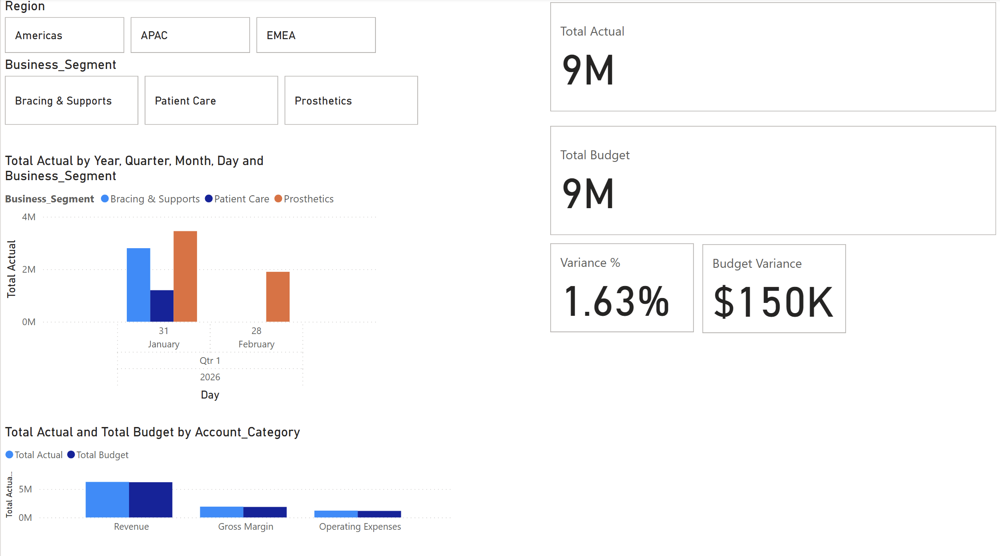

# Embla Medical - Financial & Variance Performance Dashboard

[← Back to Main Portfolio](/)

---

### Executive Summary
This project features an interactive executive financial dashboard built in **Power BI Desktop**, designed specifically to model financial operations for **Embla Medical**. The dashboard gives finance leaders real-time visibility into Actual vs. Budgeted revenue and expenses across global regions (**Americas**, **EMEA**, **APAC**) and business segments (**Prosthetics**, **Bracing & Supports**, **Patient Care**).

---

### Visual Dashboard Overview

---

### Key Financial DAX Metrics & Business Logic

The model uses custom DAX measures to calculate absolute dollar variance and percentage variance dynamically across all filters:

#### 1. Aggregations (Actual vs. Budget)
---

### Project Deliverables
* 📊 **[Download Power BI File (.pbix)](/files/Embla_Financial_Performance.pbix)**
* 🖼️ **[View Full Dashboard Screenshot](/images/embla_dashboard_thumb.png)**

---

### Design & Technical Specifications
* **Visual Palette:** Executive Deep Slate Navy (`#1E293B`) background containers with Financial Blue (`#2563EB`) chart elements.
* **UI Elements:** Rounded container borders (`10px`), horizontal region/segment tile slicers, and side-by-side KPI cards displaying dollar variance alongside percentage variance.

---

[← Back to Main Portfolio](/)
