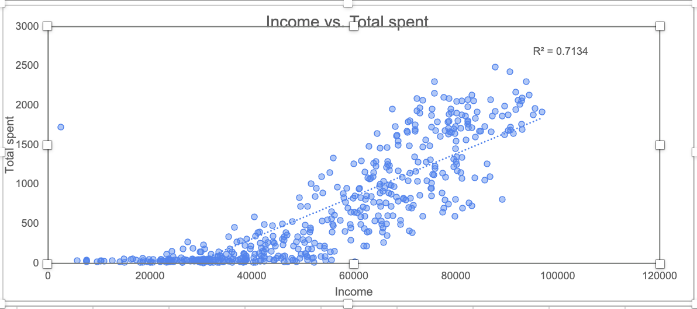
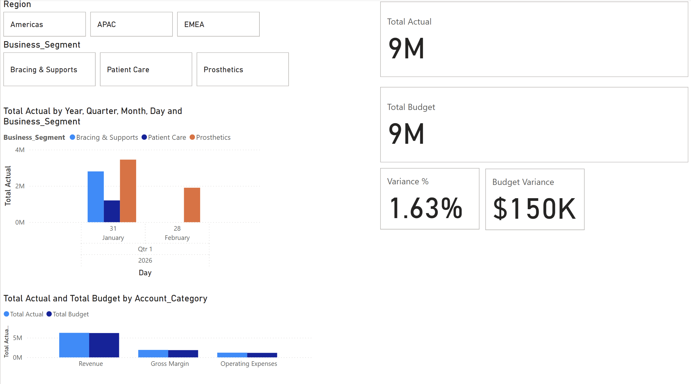

# Welcome to My Analytics Portfolio

I am a Data Analyst specializing in operational throughput, statistical modeling, and interactive visual analytics. Below are select projects demonstrating end-to-end data pipelines, business capability analysis, and interactive dashboards.

---

## Featured Projects

#### [1. Customer Delivery Spend & Segmentation Analysis](https://github.com/YourGitHubUsername/food-delivery-analytics)

Statistical analysis evaluating correlations between household income levels, family size, and average order value using R and Excel.

* 🔗 **[View Full Case Study on LinkedIn](https://www.linkedin.com/pulse/what-drives-food-delivery-spending-south-america-look-briaheim-evans-emusc/)** — *What Drives Food Delivery Spending in South America? A Look Inside the Numbers.*

---

#### [2. Embla Medical - Financial & Variance Performance Dashboard](/embla_financial_dashboard)

This project features an interactive executive financial dashboard built in **Power BI Desktop**, designed specifically to model financial operations for **Embla Medical**. The dashboard gives finance leaders real-time visibility into Actual vs. Budgeted revenue across global regions (**Americas**, **EMEA**, **APAC**) and business segments (**Prosthetics**, **Bracing & Supports**, **Patient Care**).

#### [3. Massachusetts Public School Readiness & Performance Analysis](https://github.com/YourGitHubUsername/ma-public-schools-analysis)

Statistical analysis evaluating correlations between class sizes, 4th-grade MCAS math proficiency, and college attendance rates across 1,861 Massachusetts public schools using Tableau.

- 🔗 **[View Full Case Study on LinkedIn](https://lnkd.in/p/dUiZuv48)** — *How Well Do Massachusetts Public Schools Prepare Students for Higher Education?*

---

## Technical Skill Set

- **Data Analysis & Querying:** SQL, R, Python, Microsoft Excel
- **Data Visualization:** Power BI, Tableau, R Markdown / Shiny
- **Systems & Workflow:** dbt, Data Modeling, Git / Version Control

---

## Contact & Resume

- 📄 **[Download Full Resume (PDF)](/files/Briaheim_Evans_BusinessIntelligence_Resume.pdf)**
- 💼 **[Connect on LinkedIn](https://linkedin.com/in/briaheim-evans)**
